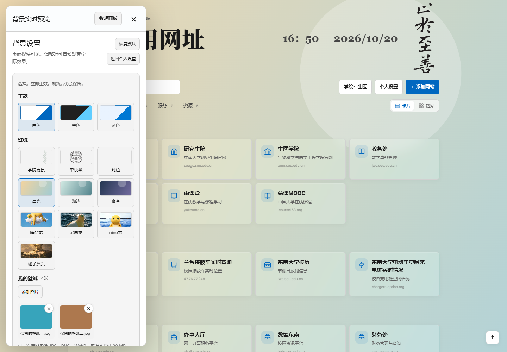

<div align="center">

# 东南大学个人导航

**把分散的校园网站，整理成一张真正属于自己的东大导航页。**

支持 38 个学院版本、卡片与磁贴切换、收藏置顶、网站增删与拖拽、分类管理和主题壁纸；个人设置保存在浏览器中，打开即可使用。

### [立即在线体验 →](https://dongbaiwei.github.io/Seu-Web-Navigator/)

</div>


## 为什么值得体验

- **一个页面找到常用入口**：默认收录研究生院、教务服务、图书馆、就业、校历、校园交通等 23 个常用网站。
- **38 个学院版本随时切换**：可按学院全称、简称、拼音或首字母搜索，标题、学院官网和右侧主题图案会同步更新。
- **越用越像自己的主页**：网站可以新增、删除、移动和拖拽排序，分类、标题、卡片和背景也能自行调整。
- **两种浏览方式自由切换**：卡片呈现名称、说明和域名；磁贴突出图标，详情按需展开，选择会自动保留。
- **常用入口自动置顶**：收藏网站后，首页自动出现收藏区；滚动时分类栏始终可见。
- **设置会自动保留**：下次打开仍然是熟悉的学院、布局和主题，无需注册账号。
- **适合继续改造**：项目是纯静态页面，可以直接 Fork，换成自己的校园、学院或个人网址导航。

## 卡片还是磁贴，由你选择

分类栏右侧可切换卡片与磁贴视图。两种视图共享收藏、自定义网站和排序；磁贴中的“查看详情”可展开说明与域名。手机端自动适配列数，滚动时仍可切换分类和显示方式。


## 从学院版本开始

选择自己的学院后，导航页会自动替换学院名称、官网入口和背景图案。搜索支持“生医”“BME”“计算机”“JSJ”等名称与关键词。

正式名称为三字或四字时显示全称，例如“法学院”“数学学院”“体育系”；长名称使用常用简称，例如“信科”“生科”“生医”。


## 把页面调成喜欢的样子

个人设置集中提供五类定制能力：

| 设置 | 可以调整的内容 |
| --- | --- |
| 分类管理 | 新增、重命名、隐藏、排序和删除分类，移动网站 |
| 页面标题 | 使用学院默认标题，或填写自己的导航名称 |
| 显示设置 | 时钟、学院说明、校训、底部装饰、实用项目列表 |
| 卡片外观 | 卡片密度、桌面列数、圆角、透明度、毛玻璃强度和序号开关 |
| 背景设置 | 白/黑/蓝主题、学院背景、单校徽、纯色、自定义图片和图案浓度 |

背景设置采用侧边实时预览，调整主题、壁纸、校徽和学院图案时，可以直接看到整页效果。

内置“晨光”“湖边”“夜空”“睡梦龙”“沉思龙”“nine龙”“橘子洲头”七张壁纸，打开即可选择，并自动记住当前选择。

“我的壁纸”支持一次添加多张图片，保存后通过缩略图随时切换，也可以单独删除。壁纸保存在当前浏览器，刷新或下次打开仍会保留；不同设备和本地预览之间不会自动同步。



## 你可以直接做什么

1. 点击 **学院**，找到并保存自己的学院版本。
2. 点击 **添加网站**，把个人常用入口放入任意分类。
3. 直接拖动网站卡片，调整常用网站的先后顺序。
4. 在 **个人设置** 中修改分类、页面标题、显示内容、卡片外观和背景。
5. 输入关键词即可搜索；回车立即搜索，Esc 清空搜索。
6. 点击星标收藏网站，首页自动置顶展示；取消全部收藏后，收藏区自动隐藏。
7. 首次打开可通过轻提示选择学院；底部和个人设置中都能重新查看使用提示、反馈问题或推荐网站。

资源区还提供“实用项目与脚本”推荐，目前收录：

- [东南大学研究生课程资料整理](https://github.com/oneman233/seu-master)
- [东南大学学生手册 Skill](https://github.com/Andiii208/seu-handbook-skill)
- [鼠鼠实习妙妙工具](https://github.com/LiuMengxuan04/shushu-internship-tool)

## 数据与隐私

学院选择、自定义分类、页面标题、卡片外观、自定义网站、收藏、访问记录和上传壁纸都只保存在当前浏览器的本地存储中，不会上传到服务器。

这也意味着：

- 不同浏览器和设备之间不会自动同步。
- 清除该网站的浏览器数据会删除个人设置。
- 项目更新不会覆盖访问者已经保存的设置。

反馈功能由你主动选择邮件或 GitHub，最终发送或提交由你确认。整理的反馈会包含填写的内容、当前学院、卡片或磁贴视图，以及不含查询参数和片段的页面地址。

## 反馈问题与推荐网站

网站底部和个人设置中均提供反馈入口，可报告链接失效、推荐网站或提出改进建议。

- 邮箱：[2659385932@qq.com](mailto:2659385932@qq.com)，支持点击打开邮件应用，也可以复制邮箱。
- [GitHub Issues](https://github.com/dongbaiwei/Seu-Web-Navigator/issues)：页面会整理好标题和正文，登录后由你确认提交。
- 也可以先复制反馈内容，再通过自己的联系方式发送。


## 本地运行

本项目无需构建工具。下载或克隆仓库后，在仓库目录启动任意静态文件服务器：

```bash
python -m http.server 4173
```

然后访问 `http://127.0.0.1:4173/`。直接打开 `index.html` 也可以浏览，但使用本地服务器时，资源加载和浏览器存储更稳定。

## 项目结构

```text
.
├─ index.html                 # 网站首页与默认导航数据
├─ assets/
│  ├─ personalization.js     # 学院切换和个人设置
│  ├─ personalization.css    # 个性化界面与学院背景样式
│  ├─ college-profiles.js    # 学院名称、官网与搜索关键词
│  ├─ college-art/           # 38 个学院主题图案
│  ├─ appearance.js          # 主题、壁纸和上传图片
│  ├─ custom-sites.js        # 添加、删除和管理网站
│  ├─ navigation-design.js   # 卡片/磁贴视图、图标和固定分类栏
│  ├─ pinned-favorites.js    # 首页收藏置顶
│  ├─ user-help.js           # 首次提示、邮件与 GitHub 反馈
│  └─ site-model.js          # 自定义网站数据校验
├─ docs/images/              # README 展示截图
├─ 个人定制说明.md
└─ .nojekyll
```

更完整的操作和实现说明见[个人定制说明](个人定制说明.md)。

## 部署自己的版本

1. Fork 或下载本仓库。
2. 按需要修改默认网站、学院资料与页面文案。
3. 在仓库 **Settings → Pages** 中选择 `Deploy from a branch`。
4. 发布分支选择 `main`，目录选择 `/ (root)`。

推送到 `main` 后，GitHub Pages 会自动更新。

## 致谢与说明

本项目最初参考并复刻了 [seucseWeb/seucseWeb.github.io](https://github.com/seucseWeb/seucseWeb.github.io) 的页面结构与视觉风格，并在此基础上加入学院切换、个人定制、主题壁纸和导航管理功能。

本项目是非官方学生项目，与东南大学官方无隶属关系。东南大学名称、校徽及学院名称等标识归其相应权利人所有；网站链接与开放时间请以对应单位的官方信息为准。

如果这个项目对你有帮助，欢迎 Star、Fork，或把它改成属于你的校园导航页。
